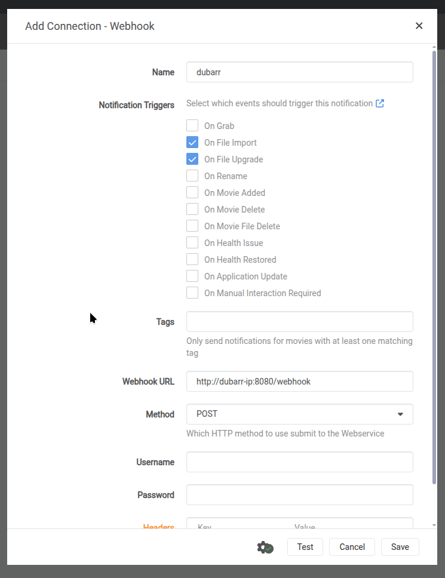

# dubarr 🎬

> [!NOTE]
> This is a hobby project ("toy"), created entirely in **vibe-coding** mode (AI-driven development).

An automated system for creating professional AI-powered dubbing (voice-over) using **fully local** AI models. Designed to sit next to the `*arr` stack (Radarr/Sonarr) for feature-length movies and TV series.

**Private and local: no cloud AI APIs.** The only optional network calls are show/movie metadata lookups (TVmaze,
TMDB), which `METADATA_LOOKUP=local` turns off.

---

## 🌟 Key Features
*   **In-Place Multi-Track Processing**: Adds "AI - [Language]" audio tracks in front of the original audio of your
    existing files (MKV, MP4, MOV). The original audio stays in the file, and the untouched source is kept as `<file>.bak`.
*   **Whole-Sentence, Timing-Aware Translation**: Lines are translated by sentences, in windows with context, with a
    syllable budget per line and a second pass that restores lost information. Short and long variants let each line
    fit its slot without dropping content.
*   **Voice Cloning That Checks Itself**: OmniVoice clones each speaker from their own clips (or a designed voice when
    no clean clip exists). Every line is synthesized twice and a take judge (artifacts, voice match, text match) keeps
    the better take; broken lines are left undubbed rather than garbled.
*   **Series Memory**: Episodes of a series share name pronunciations and a voice bank, so the same person keeps the
    same voice from episode to episode.
*   **Show and Movie Context**: Recognizes Sonarr/Radarr file names and fetches synopsis and cast (`.nfo`, TVmaze,
    TMDB) so the translator knows who speaks and uses the right grammatical gender.
*   **Subtitle-Assisted Transcription**: Uses external or embedded subtitles as ground truth for names and terms.
*   **Cinematic Mix**: The dub is mixed over the original audio with sidechain ducking and a low-passed "ambient ghost"
    of the original, so the room sound and effects stay.
*   **GPU-Aware**: Spreads the LLM and speech synthesis over several cards, serializes them on one card, or runs on
    the CPU. The LLM can also run in an existing llama.cpp / OpenAI-compatible server.

---

## 🎬 Demo

**Latest build:** one line from a public-domain NASA interview, first in English, then dubbed into Polish. It is
regenerated by the CPU E2E workflow on every change to `main` (small CPU models, so the GPU setup sounds better).

[](https://github.com/neutrinus/dubarr/releases/download/demo/demo.mp4)

Older comparison demo (Polish, French and German, GPU models):

[](https://www.youtube.com/watch?v=MkJtJ11j_BU)

> [!TIP]
> Notice how the AI maintains the same voice characteristics and emotional tone across all target languages while blending with the original background atmosphere.

---

## 💻 Hardware Requirements

Dubarr detects your hardware at startup: with two or more GPUs the LLM and speech synthesis run side by side on
different cards; with one GPU or none, an inference lock lets only one model work at a time. Whisper, pyannote and
Demucs are loaded for their stage and unloaded right after. The take judge's small models run on the CPU.

| Setup | VRAM | Mode | Description |
| :--- | :--- | :--- | :--- |
| **Multi-GPU** | ~20GB combined (e.g. 12GB + 8GB) | parallel | LLM on one card, speech synthesis on the other. Needs ~6GB free on the TTS card for long lines. |
| **Single GPU** | 12GB+ (e.g. 3060 12GB) | serialized | The inference lock switches between the LLM and the TTS, preventing Out-Of-Memory errors. |
| **External LLM** | ~6GB for the TTS | parallel | `LLM_API_URL` points at a llama.cpp / OpenAI-compatible server; dubarr loads no LLM itself. |
| **CPU Only** | N/A (32GB RAM rec.) | serialized | LLM and Whisper are 10-20x slower; speech synthesis is **15-40x slower** than realtime (a 10s line takes 2-4 min on 8 cores). |

Measured on a 3060 12GB + 3070 8GB pair, dubbing one 10-minute episode (720p, one target language):

| Stage | VRAM peak | Time |
| :--- | :--- | :--- |
| Audio separation (Demucs) | ~2 GB | 1:30 |
| Diarization + Whisper `large-v3-turbo` | ~4 GB (unloaded after use) | 0:45 |
| Global analysis + drafts (Gemma 3 12B, 8k context) | ~10 GB | 3:30 |
| Speech synthesis (OmniVoice) | **up to 6 GB** for very long lines | 3:50 |
| Mix + mux | – | 0:15 |

These timings predate two takes per line (`TAKE_VERSIONS=2`) and the take judge, so expect speech synthesis to take
roughly twice as long now.

> [!TIP]
> Sharing a card with another service (a household `llama-server`, Jellyfin transcoding, ...)? Keep about
> **6 GB free** on the card that runs speech synthesis. Dubarr puts the TTS server on the card with the most free
> VRAM, so if the LLM hogs the small card, give it a smaller share of that card (e.g. llama.cpp
> `--tensor-split 28,2` with more `--n-cpu-moe` layers) instead of shrinking its context. The peak also grows with
> the length of a single line, which is why long lines are synthesized in ~10s chunks.
>
> With no headroom at all, set `TTS_DEVICE=cpu`: dubbing then runs on the CPU, the GPUs stay with the LLM,
> and synthesis takes roughly 10-30x longer than on a GPU.

---

## ⚡ Performance & Speed

Dubarr optimizes for dub quality, not speed: it translates in several passes, synthesizes every line at least twice
and judges each take. Processing takes a few times the video duration per target language on a GPU and grows with
the number of languages and speakers. Most of the time goes to the LLM and to speech synthesis.

---

## 🚀 Getting Started

### 1. Prerequisites
*   **NVIDIA GPU** with the [NVIDIA Container Toolkit](https://docs.nvidia.com/datacenter/cloud-native/container-toolkit/) (see the hardware table).
*   **Hugging Face Token** for pyannote (speaker diarization and voiceprints). Accept the terms of
    [pyannote/speaker-diarization-community-1](https://huggingface.co/pyannote/speaker-diarization-community-1) with the
    account that owns the token. All other models are downloaded on first use into `DATA_DIR`.

### 2. Deployment (Docker Compose)
The easiest way to run `dubarr` is using Docker Compose. The image is automatically built and published to `ghcr.io`.

```yaml
services:
  dubarr:
    image: ghcr.io/neutrinus/dubarr:main
    container_name: dubarr
    ports:
      - 8000:8000
    environment:
      - PUID=1000        # container runs as this UID/GID, never as root
      - PGID=1000
      # - FIX_MEDIA_PERMISSIONS=1  # recursively chown the media library (slow; only if it is not readable)
      - HF_TOKEN=your_token_here
      - TARGET_LANGS=pl
      - AUDIO_CODEC=aac # Optional: codec of the dubbed tracks, "aac" (default, plays in browsers and on phones), "ac3", "eac3"
      - METADATA_LOOKUP=on # Optional: look up the show/movie (synopsis, cast) for the translator: "on", "local" (.nfo only), "off"
      - TMDB_API_KEY= # Optional: TMDB key for movie metadata (episodes use TVmaze, no key needed)
      - DATA_DIR=/app/data # Mount point for all app data (DB, logs, models, caches)
      - API_USER=dubarr # Optional: Custom API username
      - API_PASS=dubarr # Optional: Custom API password
    volumes:
      - ./data:/app/data          # Persistent storage (DB, logs, models, caches)
      - /path/to/media:/app/videos # Your movie/tv library
    deploy:
      resources:
        reservations:
          devices:
            - driver: nvidia
              count: all
              capabilities: [gpu]
    restart: unless-stopped
```

Mount the media library so that the paths you send to dubarr exist inside the container. Using the same path as in
Sonarr/Radarr (e.g. `/tv:/tv`) saves you from translating paths.

### 3. Usage
`dubarr` works as a service. Queue a file with the webhook, or upload one on the dashboard (`http://localhost:8000/`).

```bash
curl -u dubarr:dubarr -X POST http://localhost:8000/webhook \
  -H "Content-Type: application/json" \
  -d '{"path": "/movies/Diuna/Dune.mkv"}'
```

**Sonarr / Radarr:** add a *Webhook* connection (Settings → Connect) with the *On File Import* and *On File Upgrade*
triggers, URL `http://<dubarr-host>:8000/webhook`, method POST, and the `API_USER` / `API_PASS` credentials. Dubarr
reads the imported file's path from their payload, so mount the library at the same path in both containers.



(The screenshot uses port 8080; the default is 8000. Fill in the username and password.)
Other endpoints (`/download`, `/retry`, `/debug`, `/health`, `/ws/logs`) are described in
[Spec 004](specification/specs/004_api_interface.md).

### 4. Configuration
Everything is configured with environment variables. The ones you are most likely to touch:

| Variable | Default | Meaning |
| :--- | :--- | :--- |
| `TARGET_LANGS` | `pl` | Comma-separated target languages. |
| `HF_TOKEN` | none | Hugging Face token (required). |
| `LLM_API_URL` / `LLM_API_MODEL` | none | Use an existing OpenAI-compatible server (e.g. `http://llama:8080/v1`) instead of loading Gemma 3 12B in-process. |
| `TTS_DEVICE` | `auto` | `cpu` keeps the GPUs free for other services (much slower). |
| `METADATA_LOOKUP` / `TMDB_API_KEY` | `on` / none | Show/movie context: `.nfo`, then TVmaze (episodes) or TMDB (movies, needs a key); `local` or `off`. |
| `SERIES_MEMORY` | `on` | Share name pronunciations and voices between the episodes of a series. |
| `DEBUG` | `0` | Keep intermediate files and a per-line report in `videos/debug_<name>/`. |
| `API_USER` / `API_PASS` | `dubarr` / `dubarr` | Basic auth for the API. |

The full list, with every tuning knob, is in [Spec 005](specification/specs/005_deployment_and_configuration.md#2-configuration).

---

## 🏗️ The Pipeline (Step-by-Step)

1.  **Audio Separation**: Demucs `htdemucs_ft` isolates the voices from music and effects.
2.  **Audio Analysis**: pyannote finds who speaks when; faster-whisper (`large-v3-turbo`) transcribes the original
    mix, with a second pass for speech under loud noise. Lines are joined into whole sentences, each with a time budget.
    The show/episode or movie is identified and its synopsis and cast are fetched.
3.  **Global Analysis**: the LLM (Gemma 3 12B in-process, or your own server) writes a summary, speaker profiles and
    a pronunciation glossary for names, and corrects transcription errors (using subtitles when available).
4.  **Voice References**: the cleanest, calmest clips of each speaker are picked (plus voice-bank clips from earlier
    episodes of the series).
5.  **Production**: translation in windows with per-line syllable budgets and a completeness review; a voice
    audition ranks each speaker's references; then every line is synthesized with OmniVoice, judged, and shortened or
    restored by the LLM until it fits its slot.
6.  **Final Mix**: the dub goes over the original audio with sidechain ducking and an "ambient ghost" of the original.
7.  **Muxing**: the "AI - [Language]" tracks are added to the file in place.

The detailed behaviour is specified in [`specification/`](specification/): the pipeline in
[Spec 001](specification/specs/001_video_processing_pipeline.md), the sync loop and take judge in
[Spec 002](specification/specs/002_synchronization_engine.md), the series memory in
[Spec 006](specification/specs/006_series_memory.md).

---

## 📊 Monitoring & Debugging
*   **Web Dashboard**: Access the management interface at `http://localhost:8000/` to view the task queue, monitor video metadata (size, duration, languages), and track live processing progress with real-time timers.
*   **Live Logs**: Integrated WebSocket-based log viewer in the dashboard.
*   **Artifacts**: With `DEBUG=1`, individual audio segments, LLM translations and `report_<lang>.tsv` (every line
    with its timing, voice reference, judge score, source and dub text) are saved in `videos/debug_<name>/`.
*   **Development**: see [AGENTS.md](AGENTS.md) for the repository map, tests and conventions.

---

## 🔗 Similar Projects
*   [Open Dubbing (Softcatala)](https://github.com/Softcatala/open-dubbing) - Focusing on open datasets and Catalan.
*   [PyVideoTrans](https://github.com/jianchang512/pyvideotrans) - Comprehensive GUI-based tool.
*   [VideoTranslator](https://github.com/davy1ex/videoTranslator) - Various local/cloud engine support.
*   [Dubarr](https://github.com/p1zzm1ssile/Dubarr) - Another project with a similar name.

---

## ⚖️ License
[LICENSE](LICENSE)
